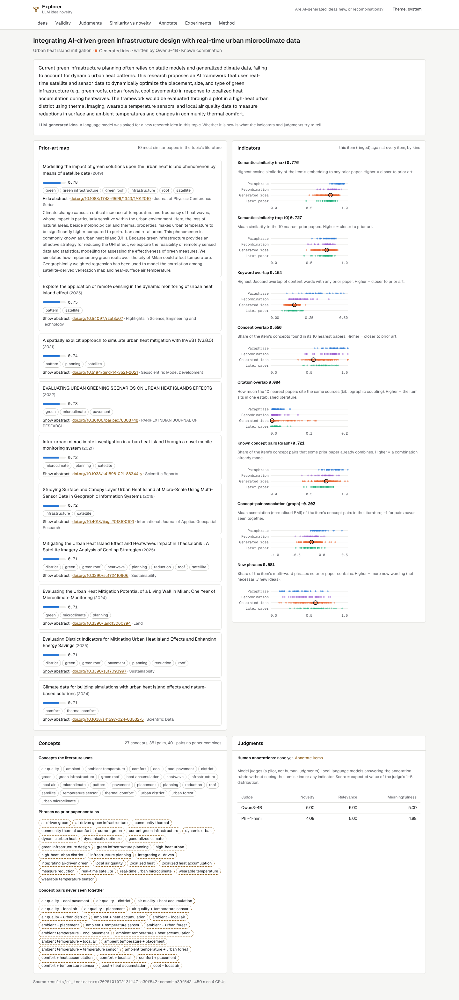
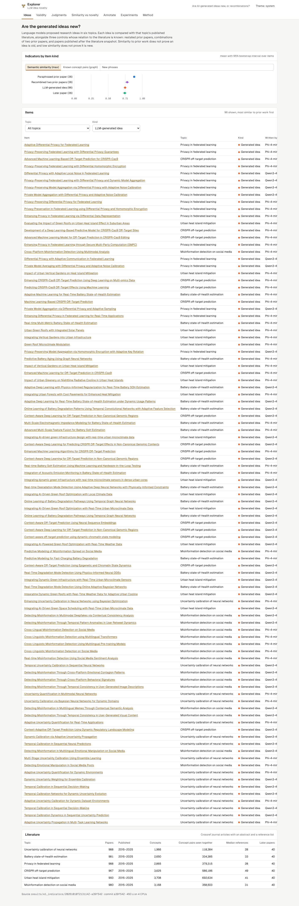
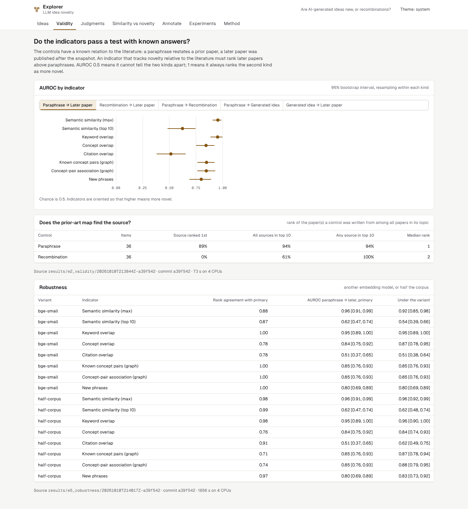
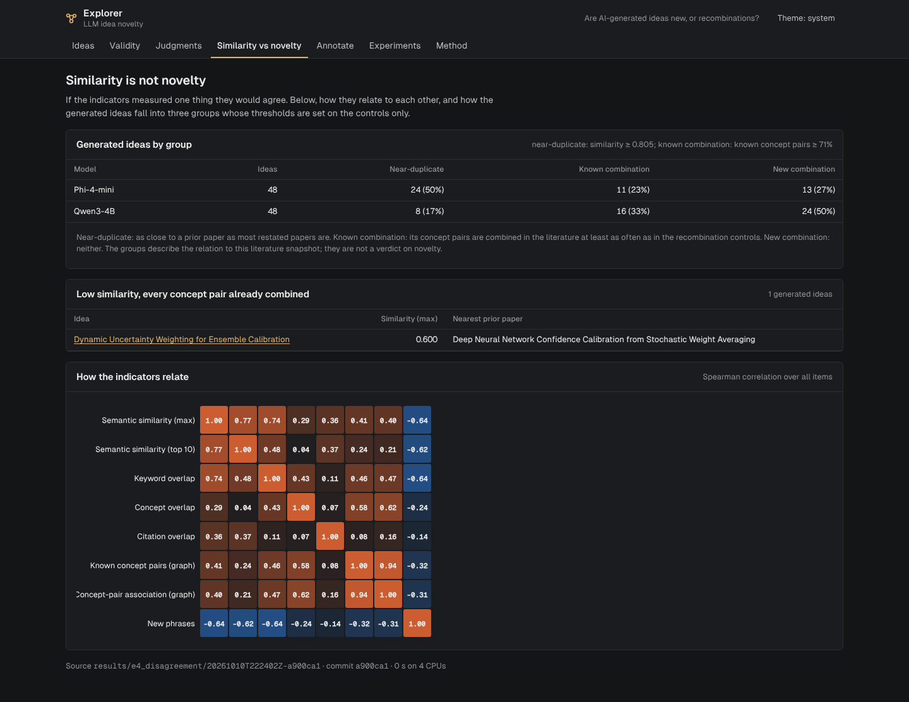
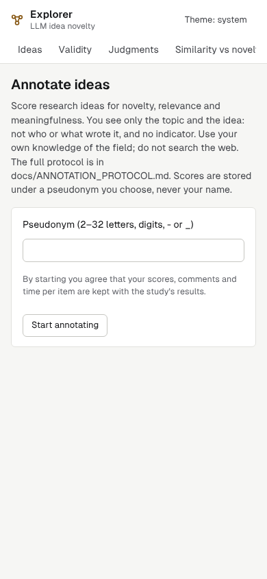

# LLM novelty vs recombination analyzer

Are research ideas written by language models new, or mostly recombinations of what is already
published? Semantic similarity to prior papers does not prove or disprove novelty, so this project
builds eight computational novelty indicators, tests them against controls whose relation to the
literature is known, and asks whether they agree with judgments of novelty.

Pipeline: **generated idea → concept extraction → literature retrieval → semantic comparison →
prior-art mapping → novelty indicators → indicators against judgments**.

**Material.** Six research topics, each with about 1,000 Crossref journal articles (2015–2025,
abstract and reference list deposited; 5,897 papers). 96 ideas from two local open-weights models
(Qwen3-4B-Instruct, Phi-4-mini-instruct) and 108 controls written in the same format: restated
prior papers, recombinations of two prior papers, and papers published in 2026, after the corpus.



## Results

Measured by `make experiments` on clean commits; every number is in
[docs/generated/results.md](docs/generated/results.md), written up in [docs/REPORT.md](docs/REPORT.md).

- **The indicators pass a test with known answers.** Highest semantic similarity separates restated
  prior papers from later papers with AUROC 0.96 [0.91, 0.99]; keyword overlap 0.95, the two graph
  indicators 0.85. Citation overlap and mean top-10 similarity do not beat chance.
- **Generated ideas look like later papers, not like restatements.** The 96 ideas are hard to tell
  apart from real papers the corpus has never seen (AUROC 0.47–0.62; seven of eight intervals
  include 0.5). Only the share of known concept pairs leans slightly towards later papers being
  newer (0.62 [0.51, 0.73]).
- **But most of them combine what is already combined.** 71% of a generated idea's concept pairs
  already co-occur in some prior paper (later papers 66%, restatements 80%). Using thresholds set
  on the controls, 32 of 96 ideas are near-duplicates of a prior paper, 27 known combinations and
  37 new combinations of this literature; Phi-4-mini wrote 24 of the 32 near-duplicates.
- **Similarity is not novelty.** Semantic similarity and the share of known concept pairs
  correlate only at ρ = 0.41.
- **Judgments.** The human study is *pending* (the annotation interface and protocol are built; no
  annotations collected). In a clearly labelled pilot with the two local models as judges, the
  strongest indicator correlates with mean novelty at ρ = 0.33 [0.20, 0.44]. The judges agree in
  ranking (Spearman 0.71) but not in level (weighted κ 0.08), and Qwen rates its own ideas higher
  (4.49 vs 3.92). The pilot is not evidence about human judgment.
- **Robust to the embedding model and corpus size** (rank agreement 0.71–1.00; validity AUROCs
  unchanged within their intervals).

## What is built

- `src/novelty`: Crossref corpus from a DOI manifest; generation of ideas and controls with local
  models (llama.cpp); concept extraction (RAKE-style phrases, no external NLP model); embeddings;
  a concept co-occurrence graph per topic; eight indicators; model-judge pilot; experiments E1–E5
  with versioned results and provenance.
- **LLM Idea Novelty Explorer** (`web/`): ideas and controls with their indicators, an item view with
  its prior-art map and concept pairs, validity, judgments, similarity-vs-novelty, an annotation
  page that hides each item's kind and indicators, experiments and method. Light/dark, keyboard
  accessible, axe-checked.
- Read-only FastAPI service; annotations are the only write and are validated.

## Quick start

```bash
make setup          # uv + npm
make data           # rehydrate the Crossref corpus from the committed DOI manifest
make experiments    # THE one command: E1–E5 on the committed items and judgments + results.md
make serve          # explorer on http://127.0.0.1:8000
make test lint      # unit, pipeline and API tests; ruff, mypy strict, ESLint, tsc
make test-ui        # browser and accessibility tests
```

Regenerating the ideas or judgments needs the local models (`make setup-llm models generate judge`,
hours on CPU); the committed `items/` make that optional.

## Screenshots

| | |
|---|---|
|  |  |
|  |  |

## Documentation

[PLAN](docs/PLAN.md) · [DESIGN](docs/DESIGN.md) · [METRICS](docs/METRICS.md) ·
[DATASET](data/DATASET.md) · [ANNOTATION PROTOCOL](docs/ANNOTATION_PROTOCOL.md) ·
[DECISIONS](docs/DECISIONS.md) · [REPORT](docs/REPORT.md) · [REVIEW](docs/REVIEW.md)

## Limits

- **No human judgments yet.** The research question (do indicators track human novelty
  judgments?) stays open until the annotation study is run.
- One index (Crossref journal articles with deposited abstracts and references); work outside it is
  invisible to every indicator.
- Ideas come from two small 4-bit models; conclusions are about these models and topics.
- Controls are written by Qwen3-4B, which also judges; its own-idea preference is reported.

## Licence

Code MIT. Crossref metadata CC0; abstracts stay local and are not redistributed.
